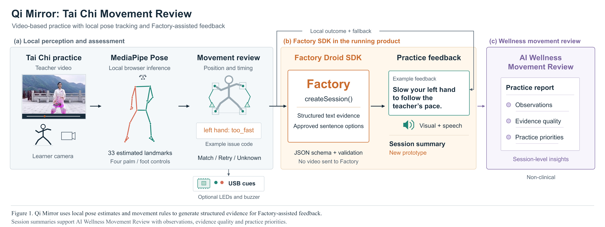

# Qi Mirror

**Tai Chi, at your own pace—with local motion tracking and an AI coaching agent powered by the Factory Droid SDK.**

**Factory runs inside the product.** Qi Mirror embeds `@factory/droid-sdk` in its live practice experience to turn a learner's movement evidence into spoken coaching and an **AI Wellness Movement Review**. Droid supports the guidance learners receive after each attempt and the practice priorities they take into their next session.

Built for **Best Use of the Factory Droid SDK**, presented by [Factory](https://docs.factory.ai/).

## Factory Droid SDK: from movement evidence to personal guidance

We bring Factory's coding agent into an interactive wellness experience as a focused coaching agent. MediaPipe observes the instructor and learner locally, and the practice engine evaluates hand and foot paths, pace, starting positions, steady holds and ending targets. Qi Mirror packages those observations as compact, structured text for a real Droid SDK session.

**Coaching for the current attempt.** Droid selects and consolidates evidence-derived coaching paragraphs that name the affected hand or foot and give a concrete practice cue. The response is validated, displayed and read aloud—for example, slowing the left hand to follow the teacher's pace. Guidance stays connected to the learner's measured movement and the selected teaching step.

**A review that remembers the lesson.** The final **AI Wellness Movement Review** draws on the complete retained attempt journal, including earlier corrections and retries. Droid turns that history into three conversational sections: **The takeaway**, **Practice priorities**, and **Next time**. The learner leaves with a useful focus for the next practice, such as rhythm, a complete movement path or a settled finishing hold.

**A responsive agent lifecycle.** Qi Mirror prepares isolated Droid sessions while the learner watches the demonstration or returns to the starting squares. Each session serves one coaching request, returns JSON Schema output and closes afterward. Instructor videos, camera frames and raw landmarks stay local; Factory receives the structured coaching evidence.



*The running product combines browser-local perception, evidence-grounded Factory coaching, visual and spoken feedback, and optional USB cues.*

### Where Droid does the work

The runtime adapter imports **`@factory/droid-sdk/node`** and uses **`createSession()`**, **`session.stream()`** with **`OutputFormatType.JsonSchema`**, and **`session.close()`**. The installed SDK is pinned to **0.9.1**.

| Product capability | Runtime endpoint | Implementation |
| --- | --- | --- |
| Spoken and visual coaching after an attempt | `POST /api/practice-feedback` | [Droid session adapter](scripts/factory-practice-feedback.mjs), [coaching composition](scripts/factory-conversational-coaching.mjs) |
| AI Wellness Movement Review across the lesson | `POST /api/practice-summary` | [Summary evidence and validation](scripts/factory-practice-summary.mjs), [browser attempt journal](public/practice-session-summary.js) |
| Prepare the next isolated agent session | `POST /api/practice-feedback/warmup` | [Session preparation and lifecycle](scripts/factory-practice-feedback.mjs) |
| Check Factory configuration | `GET /api/practice-feedback/status` | [Local API server](scripts/serve-dual-view.mjs) |

The [lesson controller](public/first-three.js) connects those runtime calls to practice, feedback, speech and final review. See the [Factory integration guide](docs/factory-feedback-integration.md) for the complete architecture.

## The experience

- **Explore 24 Tai Chi forms.** An ink-inspired homepage, interactive form wheel and resource-backed loading screen lead into real instructor demonstrations.
- **Learn at your own pace.** Guided microsteps, adjustable playback speed, replay and held targets make each movement easy to revisit.
- **Practise with live movement guides.** Local MediaPipe tracking connects the learner's palm and foot centers to starting squares, movement paths and ending triangles.
- **See the movement in 3D.** A rotatable, synchronized skeleton follows the teacher's genuine recorded pose observations.
- **Bring your own instructor.** Upload a video, choose one to five teaching steps and create a custom live follow-along lesson with Factory coaching and review.
- **Hear and feel the feedback.** Browser speech presents coaching, and optional Arduino LEDs and buzzer add physical practice cues.

## Start here

| Experience | Local URL |
| --- | --- |
| **Qi Mirror homepage** | [127.0.0.1:3100/qi-mirror](http://127.0.0.1:3100/qi-mirror) |
| **24-form selection** | [127.0.0.1:3100/qi-mirror/levels](http://127.0.0.1:3100/qi-mirror/levels) |
| **Opening practice + Factory AI Wellness Movement Review** | [127.0.0.1:8766/first-three.html?step=1](http://127.0.0.1:8766/first-three.html?step=1) |

Choose **Begin this form** in the selector: the opening form launches the Factory-enabled practice engine, while the other forms load their guided Qi Mirror lessons. The homepage also opens whole-form practice. The [route map](docs/routes.md) documents the full navigation.

## Run locally

Use **Node.js 24.x**, npm and a desktop browser with camera support. Chrome is used for the browser checks.

### 1. Install the project

```sh
git clone https://github.com/OleHo370/MotionTrial.git
cd MotionTrial
npm ci
npm run setup:assets
```

The asset setup verifies the pinned MediaPipe model and prepares its local WASM runtime. Instructor clips, observation archives, Qi Mirror artwork and fonts are included in the repository.

### 2. Configure Factory

Install the tested Droid CLI:

```sh
npm install -g droid@0.244.0
```

Copy [`.env.factory.example`](.env.factory.example) to **`.env.factory.local`** in the repository root, and set your Factory API key:

```dotenv
FACTORY_API_KEY=your_factory_api_key
```

The local practice server loads that file at startup. The SDK dependency is installed by `npm ci`; the API key stays on the server. Factory's [official documentation](https://docs.factory.ai/) covers account and API access.

### 3. Start both experiences

Terminal 1—the Qi Mirror homepage and form library:

```sh
npm run dev -- --port 3100
```

Terminal 2—the opening practice engine, Factory API and optional USB feedback:

```sh
node scripts/serve-dual-view.mjs
```

Open the [Qi Mirror homepage](http://127.0.0.1:3100/qi-mirror) and begin exploring. For a production build of the Next.js experience, use `npm run build` followed by `npm start -- --port 3100`; run the practice server alongside it.

## Create a lesson from your instructor video

1. Open [opening practice](http://127.0.0.1:8766/first-three.html?step=1) and choose **Upload video**.
2. Select a browser-playable instructor recording. MP4 and WebM are supported, with files up to **500 MiB / 10 minutes**.
3. Choose **1–5 teaching steps**. Adjust the titles and start/finish times to natural movement transitions using the video preview.
4. Choose **Analyze instructor video** to extract real local MediaPipe observations and prepare the practice targets.
5. Choose **Use this lesson → Start practice**, enable the camera and follow the starting squares, movement guides and ending triangles.
6. Receive spoken coaching during practice and the Factory-powered **AI Wellness Movement Review** at the end.

The custom lesson is held locally for the current browser session. **Change video → Use built-in lesson** returns to the original opening sequence. Both lesson sources share the same live practice controller and Factory review pipeline.

## Technology

| Layer | Technologies and role |
| --- | --- |
| Interactive experience | Next.js 16, React 19, TypeScript, CSS and Qi Mirror artwork |
| Local perception | MediaPipe Pose Landmarker 1.1.1, pinned Lite model and locally served WASM |
| Practice engine | Timestamped source observations, body-relative alignment, palm/foot guides and versioned movement rules |
| AI coaching | Factory Droid SDK 0.9.1, isolated runtime sessions, streamed structured output and evidence validation |
| 3D visualization | Three.js with synchronized instructor world landmarks |
| Audio and physical cues | Browser speech synthesis and optional Arduino UNO R4 WiFi over USB |

## Repository guide

```text
app/qi-mirror/              Homepage, form selection, loading and practice routes
features/qi-mirror/         Qi Mirror components, teaching UI and interactions
config/                    Playwright test configurations
public/first-three.*       Factory-enabled opening practice experience
public/practice-*.js       Practice rules, feedback, speech and session history
public/practice-media/     Instructor clips, teaching maps and real pose references
public/qi-mirror/          Artwork, fonts and their licenses
public/mediapipe/          Local pose WASM runtime
public/models/             Pinned MediaPipe model
scripts/                   Factory service, local server, asset preparation and checks
hardware/                  Optional Arduino feedback firmware and setup
docs/                      Current guides, diagram, development history and archive
tests/                     Unit, integration and browser checks
```

The repository root keeps the project README, coding-agent guidance and framework configuration (`next.config.mjs`, `postcss.config.mjs` and `tsconfig.json`). Test configurations are grouped in `config/`; Next.js generates its local type declarations automatically. Supporting documents are organized under `docs/`: current guides at the top level, implementation history in `docs/development/`, and earlier planning, practice notes and prompts in `docs/archive/`.

Source videos, model assets, attribution records and licenses are versioned with the app. Generated diagnostics, local recordings, credentials, dependencies, build output and imported source-package backups are excluded from Git. The [documentation index](docs/README.md) is the entry point for supporting material.

## Verification

```sh
npm run typecheck
npm test
node scripts/check-recorded-video-input.mjs
node scripts/check-uploaded-lesson-reference.mjs
node scripts/check-uploaded-lesson-3d.mjs
node scripts/check-custom-lesson-summary.mjs
node scripts/check-instructor-upload.mjs
```

The upload browser check uses an actual instructor video and the real local MediaPipe model. The suite also verifies custom lesson targets, 3D synchronization, session totals, Factory request payloads and restoration of the original lesson. The core suite contains **124 passing tests**. A separate authenticated Factory check has verified the custom-lesson review through the running SDK integration.

Run browser suites against the running local app with `npm run test:e2e` or `npm run test:e2e:qi-mirror`. Add `-- --list` to inspect the discovered checks. `npm run typecheck` generates the Next.js type declarations before checking the project.

## Credits

Built with the [Factory Droid SDK](https://docs.factory.ai/) for **Best Use of the Factory Droid SDK**. Qi Mirror combines real Tai Chi demonstrations, MediaPipe, Three.js and browser speech in an experience inspired by the continuity of Tai Chi and the expression of ink.

Artwork and font provenance are documented in [Qi Mirror assets](docs/qi-mirror/assets/QI_MIRROR_ASSETS.md) and [font licenses](docs/qi-mirror/assets/QI_MIRROR_FONTS.md).
